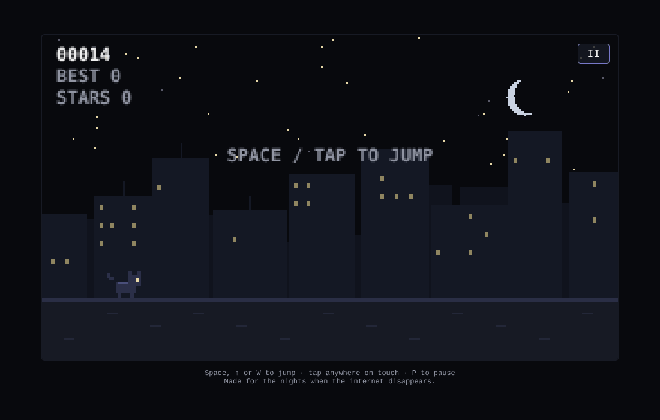
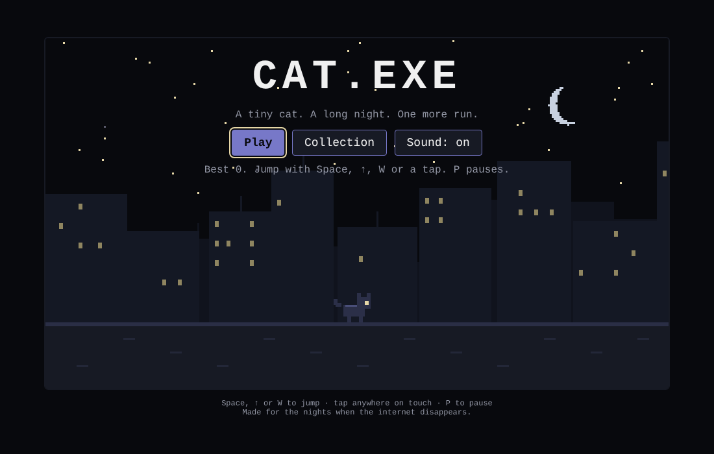
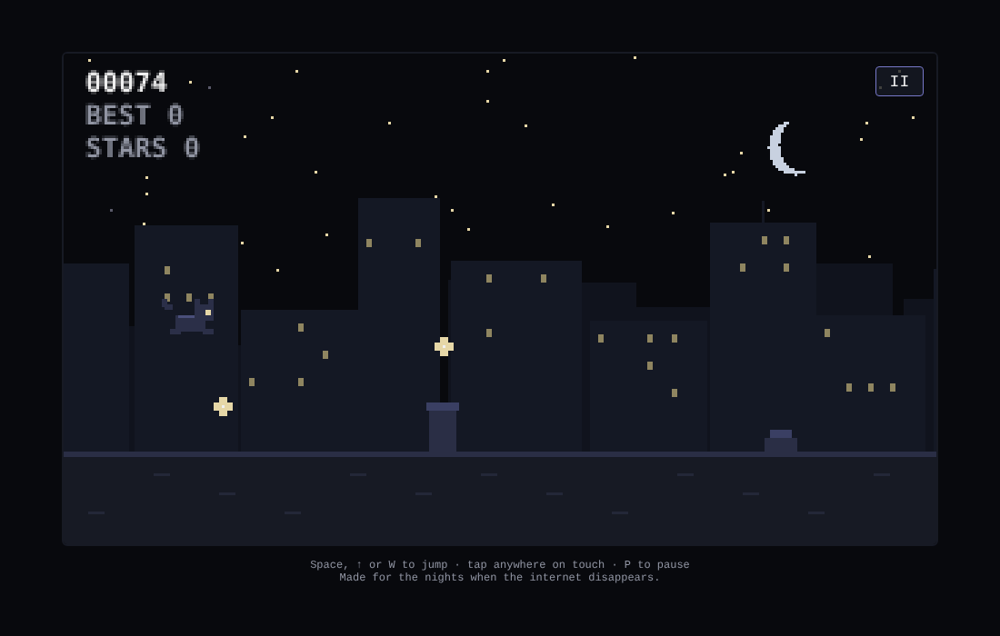
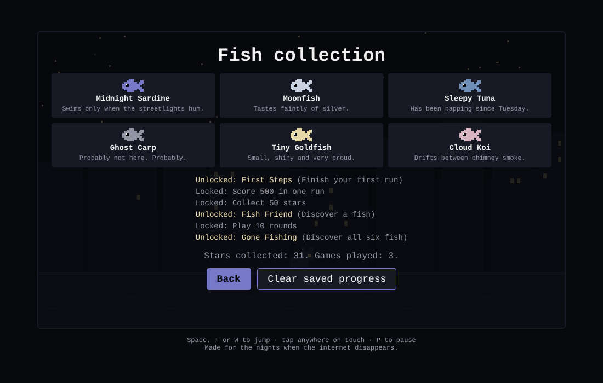
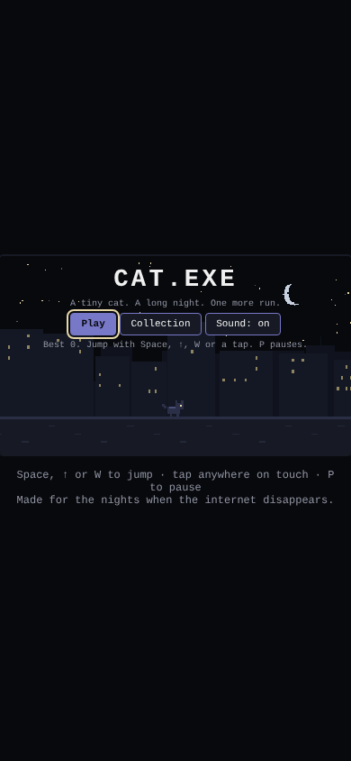
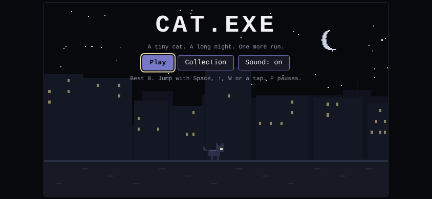

<div align="center">

# 🐾 CAT.EXE

**A tiny cat. A long night. One more run.**

*A zero-dependency, 16 KB pixel-art endless runner built with pure HTML5 Canvas & Vanilla JS.*  
*Drop it into your portfolio, 404 page, or blog in one line of code.*

[](https://mkishoredev.github.io/cat-exe/)

<br>

[](LICENSE)
[](package.json)
[](dist/cat-exe.html)
[](sw.js)
[](CONTRIBUTING.md)

<br>



</div>

<br>

---

## 🎮 Play Instantly

- **Online Live Demo:** **[mkishoredev.github.io/cat-exe](https://mkishoredev.github.io/cat-exe/)**
- **Locally:** Double-click `index.html` or run `npm start`.
- **Single File:** `dist/cat-exe.html` contains the complete game in one 16 KB file—no server or build step needed.

---

## 🚀 Add CAT.EXE to Your Website

You can embed CAT.EXE into your portfolio, personal website, 404 page, or blog in seconds. Choose the method that fits your stack:

### Method 1: The One-Line Web Component (Recommended)
Add the script tag and use the custom `<cat-exe>` tag anywhere in your HTML:

```html
<script src="https://mkishoredev.github.io/cat-exe/embed.js" defer></script>

<!-- That's it! It automatically renders a responsive 16:9 game -->
<cat-exe></cat-exe>
```

You can also customize the width or border-radius:
```html
<cat-exe max-width="800px" border-radius="16px"></cat-exe>
```

### Method 2: Universal `<iframe>` Embed
Works on any site (HTML, WordPress, Webflow, Notion, Hashnode, Dev.to):

```html
<iframe
  src="https://mkishoredev.github.io/cat-exe/"
  title="CAT.EXE"
  style="width: 100%; max-width: 640px; aspect-ratio: 16/9; border: 0; border-radius: 12px; display: block; margin: 0 auto; box-shadow: 0 16px 40px rgba(0,0,0,0.5);"
  loading="lazy"
  allow="autoplay">
</iframe>
```

### Method 3: The Ultimate 404 Easter Egg
Turn your boring 404 page into an addictive cozy sanctuary. Place this in your `404.html`:

```html
<div style="text-align: center; padding: 2rem;">
  <h1>404: Lost in the City</h1>
  <p>The page you are looking for disappeared into the night. Pet the cat while you wait:</p>
  <iframe
    src="https://mkishoredev.github.io/cat-exe/"
    style="width: 100%; max-width: 640px; aspect-ratio: 16/9; border: 0; border-radius: 12px; margin: 1.5rem auto; display: block;"
    loading="lazy">
  </iframe>
  <a href="/">← Return to Safety</a>
</div>
```

### Method 4: React / Next.js Component
Copy-paste this directly into your React / Next.js app:

```tsx
export function CatGame() {
  return (
    <div className="w-full max-w-2xl mx-auto my-6 aspect-video rounded-xl overflow-hidden shadow-2xl">
      <iframe
        src="https://mkishoredev.github.io/cat-exe/"
        title="CAT.EXE"
        className="w-full h-full border-0"
        loading="lazy"
        allow="autoplay"
      />
    </div>
  );
}
```

### Method 5: 100% Self-Hosted (Single File)
Copy [`dist/cat-exe.html`](dist/cat-exe.html) into your project's public folder. Everything (HTML, CSS, JS, sound generator, pixel engine) is compiled into that single file!

---

## 🕹️ Screenshots & Gameplay

| Menu Screen | Rooftop Run | Fish Collection |
| :---: | :---: | :---: |
|  |  |  |

| Mobile Portrait | Mobile Landscape |
| :---: | :---: |
|  |  |

---

## ⌨️ Controls

| Action | Keyboard | Touch / Mobile |
| :--- | :--- | :--- |
| **Jump** | <kbd>Space</kbd>, <kbd>&uarr;</kbd>, <kbd>W</kbd> | Tap anywhere on screen |
| **Pause / Resume** | <kbd>P</kbd> | Pause button (top right) |
| **Start / Restart** | <kbd>Enter</kbd> | Tap Start / Restart button |
| **Back from Collection** | <kbd>Esc</kbd> | Back button |

> **Pro-Tip:** Jumps are input-buffered for a few frames, so tapping slightly before hitting the roof still triggers a crisp, responsive leap. The game automatically pauses if the browser tab loses focus.

---

## ✨ Features

- **Pixel-Art Black Cat:** Custom handcrafted sprites with running, jumping, landing, sleeping, and game-over animations.
- **Atmospheric Night City:** Multi-layer parallax rooftops, dynamic moon phases, shooting stars, and a distant sleeping cat companion.
- **Fish Collection & Achievements:**
  - 6 collectible midnight fish (*Midnight Sardine*, *Moonfish*, *Sleepy Tuna*, *Ghost Carp*, *Tiny Goldfish*, *Cloud Koi*).
  - 6 unlockable achievements and a secret hidden message.
- **Zero Dependencies:** Pure HTML5 Canvas 2D and Vanilla JavaScript. No bundlers, no npm bloat, no frameworks required.
- **Fair Physics:** Dynamic jump gravity with forgiving collision bounding boxes.
- **Procedural 8-bit Audio:** Synthesized sound effects using the browser's native Web Audio API (zero audio file downloads; mute state persisted in `localStorage`).
- **Responsive 16:9 Canvas:** Crisp integer pixel-art scaling that looks sharp on iPhone, Android, or a 4K display.
- **PWA & Offline Ready:** Includes service worker caching (`sw.js`) and web manifest. Works 100% offline.

---

## 🛠️ Customization

Want to tweak the game for your own brand or site? Everything is organized cleanly in `src/game.js` and `src/styles.css`:

| Parameter | Location in `src/game.js` | Description |
| :--- | :--- | :--- |
| **Jump Height & Gravity** | `p.vy-=.45`, `p.vy=7.6` | Adjust vertical jump velocity and fall gravity |
| **Run Speed** | `Math.min(5.4,2.4+score/260)` | Change starting speed and acceleration curve |
| **Obstacle Types** | `T` array | Add chimneys, antennas, vents, water tanks |
| **Fish Collectibles** | `FISH` array | Custom names, lore descriptions, and colors |
| **Achievements** | `ACH` and `chk()` | Add your own custom badges and unlock criteria |
| **Color Theme** | `styles.css` & hex values in `draw()` | Customize sky, building, and accent colors |
| **Save Key** | `localStorage` key `catexe` | Change the storage namespace |

---

## 📁 Project Structure

```
cat-exe/
├── index.html            # Main game web shell
├── embed.js              # Drop-in <cat-exe> Web Component embed
├── favicon.svg           # Pixel cat icon
├── manifest.webmanifest  # Installable Progressive Web App (PWA) manifest
├── sw.js                 # Offline service worker cache
├── src/
│   ├── game.js           # Complete game engine, physics, audio & storage
│   └── styles.css        # Night aesthetic interface & responsive styling
├── dist/
│   ├── cat-exe.html      # 16 KB standalone single-file build
│   └── embed.js          # Web component embed script
├── docs/media/           # GIFs and screenshots
└── .github/workflows/
    └── pages.yml         # Automated GitHub Pages CI/CD deployment
```

---

## 🤝 Contributing

Contributions, new fish ideas, extra cat animations, and easter eggs are welcome!

1. Fork the repository.
2. Create your branch (`git checkout -b feature/cool-fish`).
3. Test locally with `npm start` or open `index.html`.
4. Keep it dependency-free: Vanilla JS and Canvas 2D only.
5. Submit a Pull Request.

---

## 📜 License

[MIT License](LICENSE) © 2026 Kishore M & CAT.EXE Contributors. All art is rendered in code and open for everyone to use and remix.

<div align="center">

*Made for the quiet nights when the internet disappears.*  
**Created by [Kishore M](https://github.com/MKishoreDev)** • Star ⭐ the repo if this brought a smile to your screen!

</div>
